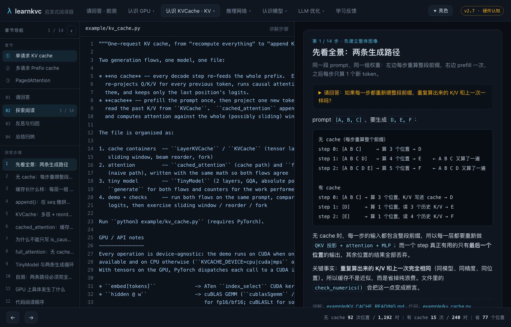

# learnkvc

用一个仓库讲清 **LLM 推理与训练**：3 份最小可运行的 KV cache 示例、7 份纯 Python 仿真、1 个零依赖交互式学习页，外加 Docker / macOS 跑真实模型的实操。

每个结论都有可执行代码和断言；不需要模型权重，clone 下来就能跑。

- **开始学习**：[在线交互页（前测）](https://newllm.github.io/learnkvc/web/#think) · [本地打开](web/index.html#think)（双击即可，离线可用）
- **分章入口**：[认识 GPU](web/index.html#gpu) · [认识 KVCache](web/index.html#kv) · [推理网络](web/index.html#net) · [认识模型](web/index.html#anatomy) · [LLM 优化](web/index.html#opt) · [学习反馈](web/index.html#feedback)

[](https://newllm.github.io/learnkvc/web/#kv/explore)

## 为什么需要 KV Cache

自回归生成时，第 `t` 个 token 的 attention 需要前 `t-1` 个 token 的 K/V。不缓存，每生成一个 token 都要把整段前缀的 K/V 重算一遍，总计算量随生成长度平方增长；缓存后每步只算新 token，总计算量线性增长。

再往上一层：多个请求常常共享同一段 prompt 前缀。每个请求都重新 prefill 这段前缀，同样的计算就会重复很多次——这是 prefix cache 要消除的浪费；PagedAttention 再把 KV 切成固定块，用 block table 管理物理显存。

## 快速开始

环境：Python 3.10+。只有 `kv_cache.py` / `paged_attention.py` / `train_tiny.py` 需要 PyTorch，其余全部纯标准库。

```bash
# KV cache 三章（可运行、带断言）
python3 example/kv_cache.py              # 需要 torch；KVCACHE_DEVICE=cpu|cuda|mps 可选
python3 example/prefix_cache_demo.py     # 零依赖：块池 / 哈希 / 引用计数 / LRU
python3 example/paged_attention.py       # 需要 torch：block table + gather
python3 example/train_tiny.py           # 需要 torch：最小训练循环 + 显存账本

# 纯 Python 仿真（零依赖，适合先看结论）
python3 example/train_sim.py             # 训练显存账本
python3 example/net_sim.py               # 推理网络总览：ring / PD
python3 example/nccl_sim.py              # NCCL：ring/tree / α-β / 拓扑
python3 example/cuda_sim.py              # CUDA：occupancy / coalescing / roofline / graph
python3 example/gpu_sim.py               # CPU vs GPU / L1-L2 / 量级对照
python3 example/ecn_sim.py               # ECN/DCQCN/PFC：标记、降速、pause
python3 example/opt_sim.py               # 优化：FlashAttention / 量化 / 投机解码
```

交互式学习页（离线可用）：

```bash
# 方式一：直接双击 web/index.html
# 方式二：起静态服务
python3 -m http.server 8000
# http://127.0.0.1:8000/web/index.html

# 改了示例 / 文档 / web/tools/*.json 后重新生成页面数据
python3 web/tools/build.py
```

## 学习地图

交互页分 5 个学习入口 + 前测/后测，共 10 个四段式章节。每章都按「**请回答 → 探索阅读 → 反思与归因 → 总结归纳**」推进：先猜，再用代码/仿真验证，最后用自己的话总结。

| 入口 | 章节 | 核心问题 | 配套 |
| --- | --- | --- | --- |
| 认识 GPU | 总览 / CUDA 执行模型 | CPU 与 GPU 怎么分工、L1/L2 与 HBM、decode 为什么 memory-bound | `gpu_sim.py`、`cuda_sim.py` |
| 认识 KVCache | 单请求 / Prefix / PagedAttention | 为什么缓存、块怎么共享、逻辑位置怎么映射到物理块 | `kv_cache.py`、`prefix_cache_demo.py`、`paged_attention.py` |
| 推理网络 | 总览 / NCCL / ECN + DCQCN | TP/EP 怎么通信、ring/tree、RoCE 怎么做到无损 | `net_sim.py`、`nccl_sim.py`、`ecn_sim.py` |
| 认识模型 | 模型解剖 / 模型训练 / 显存计算器 | 参数与结构、训练账本、这套模型能否跑在某张卡上 | `train_sim.py`、`train_tiny.py`、`anatomy.json` |
| LLM 优化 | 优化地图（FlashAttention / 量化 / 投机解码 / 调度 / 选型） | 先找瓶颈，再选 2–3 个高杠杆技术 | `opt_sim.py` |

- 前测 10 题：提交前不显示对错；学完做后测，得到按概念对照、学习完成度与错题回看。
- 每章「总结归纳」内嵌 2 题**章节测验**（提交后计分、显示解释），学习反馈页汇总各章得分；「导出 Markdown」会把参考总结、你的总结/反思/归因/测验和整章内容写成一个 `.md` 文件。
- 移动端（≤980px）代码 pane 默认折叠为「展开代码」抽屉，不占正文空间。
- 路由：`#think`、`#gpu`、`#kv`、`#net`、`#anatomy`、`#train`、`#opt`、`#feedback`；章节内可深链到步骤，如 `#cuda/3`、`#ecn/7`。
- 页面零依赖、经典 `<script>`，双击 `web/index.html` 即可离线使用。

## 目录结构

```text
.
├── example/                  # 全部可运行示例
│   ├── kv_cache.py           # 单请求：无 cache 重算 vs KV cache 增量
│   ├── prefix_cache_demo.py  # 多请求共享前缀：块池 + 哈希 + 引用计数 + LRU
│   ├── paged_attention.py    # PagedAttention：block table + gather
│   ├── train_tiny.py         # 最小 PyTorch 训练循环（需要 torch）
│   ├── *_sim.py              # 7 份纯 Python 仿真：net/train/nccl/cuda/gpu/ecn/opt
│   └── *_READING.md          # KV 三章的逐段阅读导图
├── web/                      # 零依赖交互式学习页
│   ├── index.html
│   ├── assets/               # app / workshop / 各章渲染器 / 样式
│   ├── data/                 # build.py 生成的 data.js / traces.js（提交）
│   └── tools/                # build.py、collect_traces.py、章节 JSON、题库
├── docs/images/              # README 截图
├── docker/                   # 用 Docker 跑 Ollama / vLLM
├── macos/                    # macOS 原生跑 Ollama / llama.cpp（Metal）
├── README.md                 # 本文件
└── LICENSE
```

## 文档索引

| 文档 | 内容 |
| --- | --- |
| [`example/KV_CACHE_READING.md`](example/KV_CACHE_READING.md) | 无 cache / cached attention、mask 与绝对位置、GQA、滑动窗口、reorder/fork |
| [`example/PREFIX_CACHE_READING.md`](example/PREFIX_CACHE_READING.md) | 块池、链式哈希、引用计数、LRU + 叶子淘汰、与 vLLM / SGLang 的对应 |
| [`example/PAGED_ATTENTION_READING.md`](example/PAGED_ATTENTION_READING.md) | block table、gather、内部碎片、与 vLLM 的对应 |
| [`web/README.md`](web/README.md) | 交互页：前测/后测、10 个四段式章节、图表/仿真、导航与数据管线 |
| [`AGENTS.md`](AGENTS.md) | 开发约定：单一事实来源、章节 checklist、UI/验收、数据管线 |
| [`web/DESIGN.md`](web/DESIGN.md) | 设计稿：信息架构、四段式机制、交互与验收 |
| [`docker/vllm/README.md`](docker/vllm/README.md) | Docker 跑 vLLM：PagedAttention 参数、块池日志与指标 |
| [`docker/ollama/README.md`](docker/ollama/README.md) | Docker 跑 Ollama / Llama：CPU/GPU、API、上下文与 KV cache 参数 |
| [`macos/ollama/README.md`](macos/ollama/README.md) | macOS 原生 Ollama（Metal）：安装、选型、内存与 KV cache |
| [`macos/llama-cpp/README.md`](macos/llama-cpp/README.md) | macOS llama.cpp：参数、OpenAI 兼容 API、KV cache 与调优 |

各章的内容源是 `web/tools/<chapter>.json` + `example/<chapter>_sim.py`，统一由 `build.py` 注入页面；详见 [`web/README.md`](web/README.md)。

## 跑真实模型（可选）

| 场景 | 入口 |
| --- | --- |
| Docker + GPU / CPU，看 vLLM 的 PagedAttention 参数与块池指标 | [`docker/vllm/`](docker/vllm/) |
| Docker 里跑 Ollama / Llama，调 `num_ctx` 与 KV cache 类型 | [`docker/ollama/`](docker/ollama/) |
| macOS 原生 Ollama（Metal），省心、接 OpenCode | [`macos/ollama/`](macos/ollama/) |
| macOS llama.cpp，手动调 `-c` / `-ngl` / `-ctk/-ctv` | [`macos/llama-cpp/`](macos/llama-cpp/) |

## 验证

```bash
python3 web/tools/build.py                       # 生成 data.js / traces.js，含断言
for f in web/assets/*.js web/assets/viz/*.js; do node --check "$f" || exit 1; done
```

仓库为纯静态页，`file://` 直接打开即可；所有示例可独立运行且输出确定性。

## 这个仓库是什么、不是什么

**是**：理解 KV cache、推理网络、GPU 执行与 LLM 优化的教科书式代码与仿真，逻辑完整、可断言、可修改。

**不是**：可直接上线的推理引擎。示例刻意省略真实显存分配、paged attention kernel、chunked prefill、多租户隔离、量化校准与分布式共享等生产问题；每份文档末尾都列出了这些边界。

## License

[Apache License 2.0](LICENSE)
